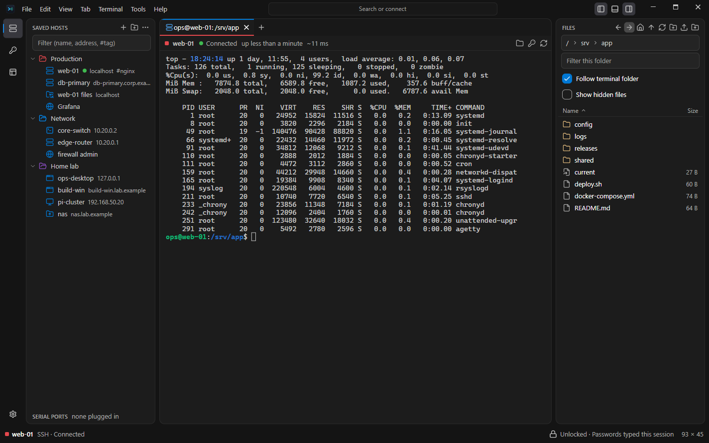

  

<h1 align="center">Relaix feedback</h1>

  Bug reports, ideas and questions for <a href="https://relaix.app">Relaix</a>: one app for SSH, SFTP, RDP, VNC,
  Telnet, FTP, serial consoles and device web pages.

  <a href="https://github.com/relaix-app/feedback/issues/new?template=bug_report.yml"><b>Report a bug</b></a> ·
  <a href="https://github.com/relaix-app/feedback/discussions/categories/ideas"><b>Ideas and votes</b></a> ·
  <a href="https://github.com/relaix-app/feedback/discussions/categories/q-a"><b>Questions</b></a> ·
  <a href="https://relaix.app/docs">Docs</a>

<picture>
  <source media="(prefers-color-scheme: dark)" srcset="images/screenshot-dark.png">
  <source media="(prefers-color-scheme: light)" srcset="images/screenshot-light.png">
  
</picture>

Relaix is in early development, so reports here shape what gets fixed and built first. The app's code isn't here:
this repository is only for feedback.

## How Relaix is made, and our promise

Yes, Relaix is made with AI. A person decides what it does and makes sure it works, and AI helps build it. That's how
a lot of software gets made these days, and we think it's a good thing when it means more people get good tools. It's
also what keeps Relaix free: it costs less to build, so you don't have to pay for it.

We get that not everyone's a fan of AI, and that's okay. Honestly, we go back and forth on it sometimes too.

What won't change: every feature is in the free version, and we'll never lock one behind a payment, a subscription or
a "Pro" tier. If you use Relaix at work, there's a license for that, but it doesn't unlock anything extra.
([More](https://relaix.app/pricing#promise))

## Report a bug

[Open a bug report](https://github.com/relaix-app/feedback/issues/new?template=bug_report.yml). It asks for what
happened, the steps, and your Relaix version (Help > About). Search the
[open issues](https://github.com/relaix-app/feedback/issues) first: if yours is there, add a 👍 and any detail that's
new.

Leave out passwords, keys, and real host names or addresses you'd rather keep private: everything here is public.

## Suggest an idea, or vote

[Ideas](https://github.com/relaix-app/feedback/discussions/categories/ideas) are in Discussions. Vote with the arrow on
an idea (a "+1" comment doesn't count), and sort by **Top** to see what people want most.

## Questions

Ask in [Q&A](https://github.com/relaix-app/feedback/discussions/categories/q-a), or read the
[docs](https://relaix.app/docs) first.

## Private matters

- **Security problems:** email security@relaix.app, privately, not here ([security page](https://relaix.app/security)).
- **Licenses, invoices, anything personal:** support@relaix.app.

## What the labels mean

| Label | Meaning |
| --- | --- |
| `bug` | A report that hasn't been looked at yet. |
| `confirmed` | Reproduced: it's a real bug. |
| `fixed in next release` | Fixed in the app; the issue closes when that release is out. |
| `needs info` | We need more detail to reproduce it. |
| `windows`, `linux` | Happens only there. |
